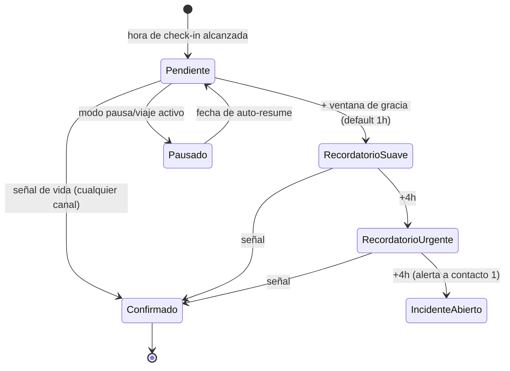
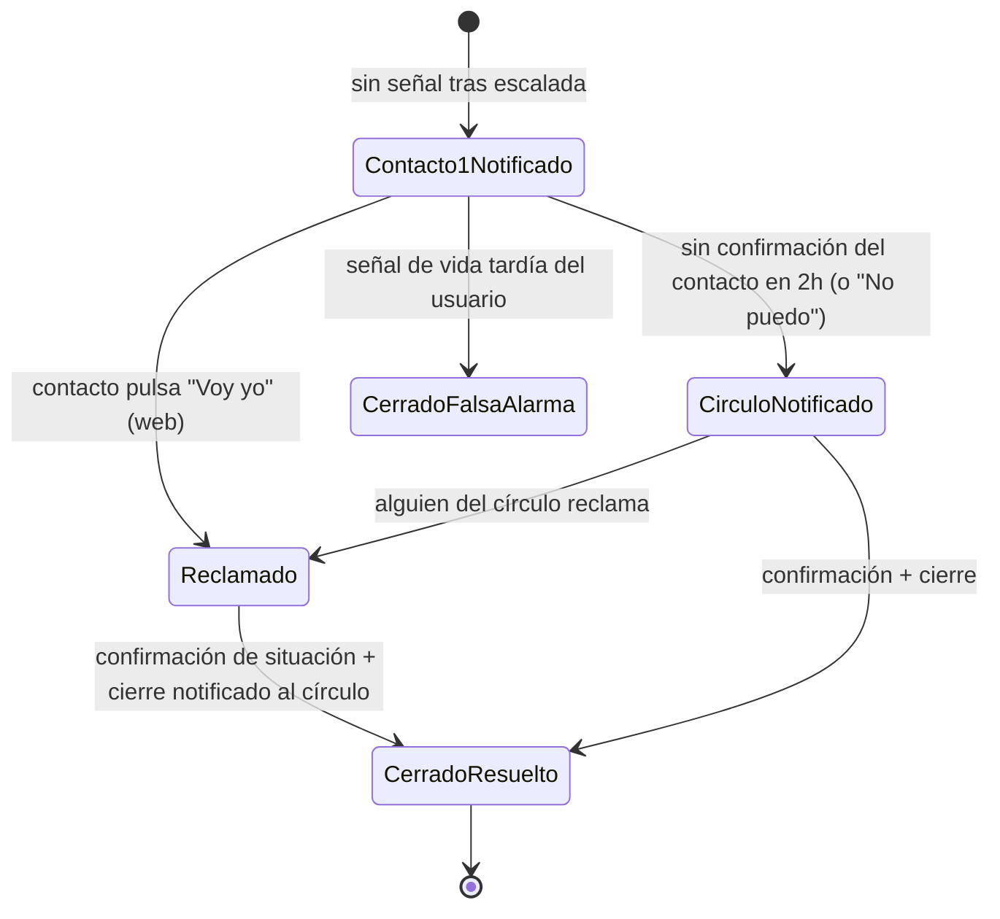

# Motor de escalada — el corazón del producto

> Última actualización: 2026-10-27. Si este componente falla, el producto falla: alguien real podría no recibir ayuda. Diseño técnico en [ADR-0004](adr/ADR-0004-motor-escalada-postgres-outbox.md).

## Responsabilidad

Dado un usuario con una hora de check-in elegida y una escalera de escalada configurada, el motor:

1. Abre el ciclo diario a la hora elegida.
2. Reacciona a señales de vida (check-in app/WhatsApp/SMS/voz/geofence/reloj) cerrando ciclos e incidentes.
3. Escala por tiempo sin señal: recordatorio suave → urgente → contacto 1 → círculo completo.
4. Gestiona el ciclo de vida del incidente hasta su cierre, notificando al círculo **sin duplicar**.
5. Honora modos especiales: pausa/viaje, zona horaria (F2), SOS (bypass de la escalera).

## Máquina de estados del ciclo diario (por usuario y día)



- Si ya había racha, el estado `Pausado` la congela en vez de romperla (R-11).
- SOS: no pasa por esta máquina — crea un incidente inmediato con countdown cancelable de 10 s.

## Máquina de estados del incidente



- **Un solo reclamante**: el primer "Voy yo" reclama el incidente; al resto se les notifica ("María está yendo") y los botones cambian de estado. Nunca dos personas montan la misma alerta.
- Toda alerta accionable incluye: quién no confirmó, desde cuándo, **última señal de vida conocida** y botones "Voy yo / No puedo" (link web firmado de un solo uso, R-08).
- La señal de vida tardía del usuario **siempre** cierra el incidente como falsa alarma y notifica al círculo que todo está bien.

## Diseño técnico

### Cola de trabajo sobre Postgres (ADR-0004)

- Tabla `escalation_jobs`: `id`, `user_id`, `kind` (reminder_soft, reminder_urgent, notify_contact, notify_circle, …), `run_at`, `state` (pending/running/done/failed/cancelled), `attempts`, `last_error`.
- Worker (Go, en `cmd/worker`), tick cada 30 s:
  ```sql
  SELECT ... FROM escalation_jobs
  WHERE state = 'pending' AND run_at <= now()
  ORDER BY run_at
  FOR UPDATE SKIP LOCKED
  LIMIT N;
  ```
- Varios workers pueden correr en paralelo sin duplicar (el row lock serializa).
- `attempts` + backoff exponencial; tras N fallos → `failed` + alerta de observabilidad (nunca silencio).
- Cancelación: cuando llega una señal de vida, los jobs pendientes del usuario se marcan `cancelled` **en la misma transacción** que registra el check-in.

### Outbox transaccional

- Cada transición de estado que requiere notificar inserta un `outbox_event` (destino, canal, payload, correlación con incidente) **en la misma transacción** que el cambio de estado.
- Un dispatcher (worker) envía a Twilio/FCM/APNs y marca `sent` / `failed`.
- Beneficio: jamás notificar algo cuyo estado no quedó grabado (ni perder notificaciones de estados grabados). Idempotencia por `event_id` hacia los proveedores.

### Reloj e idempotencia

- **Reloj inyectable**: el dominio recibe una interfaz `Clock`; los tests usan un reloj falso (el motor se prueba entero con tiempo simulado).
- Todo en **UTC** en la BD; la hora de check-in es hora-local del usuario con zona horaria explícita (F2: recalcular en viaje).
- Idempotencia: job procesado dos veces no duplica notificación (dedupe por `job.id` en outbox; dedupe por `MessageSid`/`event id` de Twilio en webhooks).
- Semántica at-least-once: aceptamos reenvío excepcional sobre pérdida; el dedupe elimina los duplicados.

### Auditoría

- Tabla `audit_events` **append-only** (sin UPDATE/DELETE, rol de BD restringido): cada transición de incidente, quién fue notificado, con qué contenido, cuándo y qué respuesta recibió.
- Es la evidencia de la promesa "best effort" (riesgo legal del spec §8). Nada de lógica de producto borra esta tabla.

## SLOs del motor

| Métrica | Objetivo | Alerta |
|---|---|---|
| Retraso de ejecución de jobs (`now - run_at` al procesar) | p95 < 60 s | crítico si > 5 min |
| Jobs `failed` | 0 sostenido | crítico al primer failed con incidente abierto |
| End-to-end señal→notificación (p.ej. check-in WhatsApp → cierre) | p95 < 10 s | warning |
| Outbox con edad > 5 min | 0 | crítico |

Ver dashboards y alertas en [observabilidad](../observabilidad/observabilidad.md).

## Cómo probarlo (obligatorio antes de tocar)

- **Reloj falso + Postgres real (testcontainers)**: simular un día completo — check-in a tiempo, ausencia total, respuesta "Voy yo", "No puedo", señal tardía, modo pausa, SOS cancelado y no cancelado.
- Propiedades invariantes: nunca notificar tras confirmación; nunca dos reclamantes; todo incidente termina `Cerrado*`; todo incidente tiene trazas de auditoría completas.
- Escenarios de caos: job falla 3 veces, dispatcher caído, reloj adelantado por DST.

## Fuera de alcance del motor (explícito)

- No decide nada médico ni de emergencias reales; solo orquesta notificaciones humanas.
- No guarda ubicación (el geofence F2 es on-device: al entrar al "home geofence" la app simplemente hace el check-in por API).
- No interpreta contenido de notas de voz (solo las transmite/transcribe en F3).
