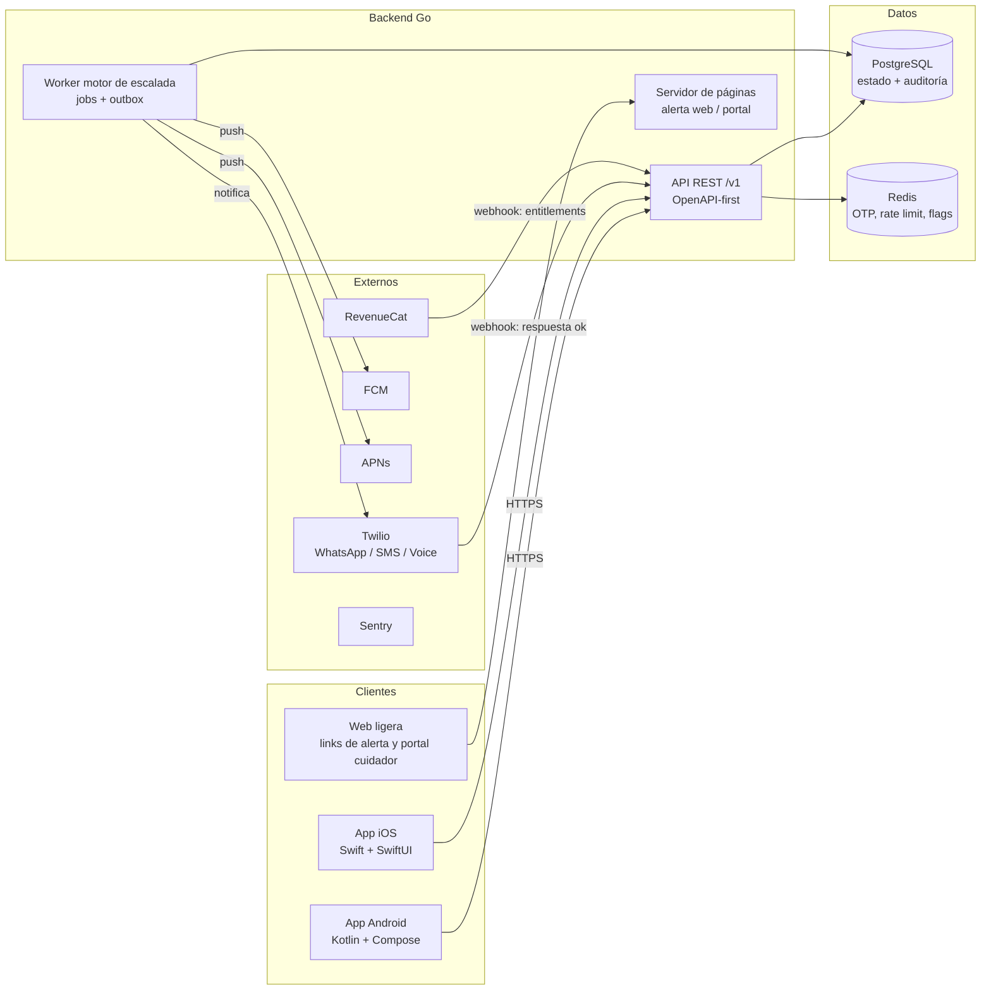

# Arquitectura del sistema

> Última actualización: 2026-10-27. Decisiones vinculantes en [adr/](adr/). Este documento describe el sistema objetivo del MVP y su evolución por fases.

## Vista de alto nivel



- **Apps nativas** (ADR-0002): cliente fino sobre la API; sin lógica de negocio crítica on-device salvo geofence (F2, 100% local).
- **API Go** (ADR-0001): REST `/v1` con OpenAPI como contrato (ADR-0003); stateless, horizontalizable.
- **Motor de escalada** (ADR-0004): worker Go sobre jobs en Postgres + outbox transaccional. Es el componente más crítico del producto; ver [motor-escalada.md](motor-escalada.md).
- **Web ligera**: las alertas a contactos y el portal del cuidador (F3) **no requieren app**: el backend Go sirve páginas server-rendered (html/template) con tokens firmados de un solo uso. Mantener este lado web sin framework JS para el MVP.
- **PostgreSQL**: fuente de verdad de todo estado (usuarios, círculos, check-ins, incidentes, jobs, outbox, log de auditoría).
- **Redis**: OTP pendientes, rate limiting, feature flags. **Nunca** estado que no se pueda perder.

## Modelo de dominio (núcleo)

| Entidad | Descripción |
|---|---|
| `User` | El usuario con app: teléfono (identidad), nombre, zona horaria, hora de check-in, plan/entitlement |
| `Contact` | Persona de confianza: nombre + teléfono, orden en la escalada, **sin cuenta** |
| `Circle` | Relación usuario ↔ contactos (el círculo que recibe alertas) |
| `CheckIn` | Señal de vida: origen (app, whatsapp, sms, voz, geofence, reloj), timestamp, opcional mood/nota |
| `EscalationPolicy` | Ventana de escalada configurada (defaults del producto) |
| `DailyCycle` | El ciclo de un día de un usuario: pendiente → confirmado / en escalada |
| `Incident` | Escalada en curso: estado, quién fue notificado, quién respondió, cierre |
| `EscalationJob` | Tarea diferida del motor (qué, cuándo, estado) |
| `OutboxEvent` | Notificación a enviar (transaccional con el cambio de estado que la origina) |
| `AuditEvent` | Append-only: toda transición de incidente (defensa legal "best effort") |
| `Entitlement` | Plan vigente (Gratis/Premium/Cuidar), reconciliado con RevenueCat |

Diagrama de estados completo en [motor-escalada.md](motor-escalada.md).

## Principios arquitectónicos

1. **Contract-first**: OpenAPI es la fuente de verdad; clientes Kotlin/Swift generados (ADR-0003).
2. **Estado solo en Postgres**: la API es stateless; el motor usa la BD como cola (ADR-0004); Redis es caché/ephemeral.
3. **At-least-once + idempotencia**: toda notificación y todo check-in es idempotente (keys de idempotencia, dedupe por mensaje de Twilio).
4. **Outbox transaccional**: nunca se notifica fuera de la transacción que cambia el estado (evita "estado dice X, familia supo Y").
5. **Mínimos datos y auditabilidad**: se guarda lo mínimo; lo que se guarda en incidentes es append-only e inmutable (requisito legal).
6. **Integraciones tras interfaces**: Twilio/FCM/RevenueCat detrás de interfaces Go propias (adapters testables con fakes).
7. **Fail-safe para el usuario**: ante cualquier error del motor, la tendencia es alertar tarde ≠ nunca; y toda alerta incluye contexto para minimizar falsas alarmas.

## Layout del monorepo (ADR-0005)

```
/backend
  cmd/api/            # servidor HTTP
  cmd/worker/         # motor de escalada + dispatcher outbox
  cmd/webpages/       # páginas web (alerta/portal) — o servicio en cmd/api, decidir en scaffolding
  internal/           # dominio y aplicaciones (ver stack/backend-go.md)
/apps/android/        # Gradle, Kotlin
/apps/ios/            # Xcode, Swift
/design/              # tokens.json, assets
/docs/                # esta documentación
/contracts/           # openapi.yaml (fuente única)
```

## Entornos

| Entorno | Uso | Datos |
|---|---|---|
| local | docker-compose (Postgres + Redis + api + worker); Twilio sandbox | ficticios |
| staging | espejo de prod para beta (10 familias) | reales pero limitados, políticas estrictas |
| producción | usuarios reales | mínimos, cifrados en reposo, auditados |

Secretos por entorno en un gestor (nunca en el repo). CI/CD en [procesos/ci-cd.md](../procesos/ci-cd.md).

## Decisiones abiertas (ADRs pendientes)

- **ADR-0006**: hosting/infra (contenedor gestionado vs k8s; recomendación inicial: gestionado, un solo cluster + Postgres gestionado).
- **ADR-0007**: cobros web/lifetime F4 (Stripe) — no bloquea MVP (RevenueCat móvil).
- Selección de proveedor de LLM/TTS para llamadas de voz F3 (no bloquea MVP).
