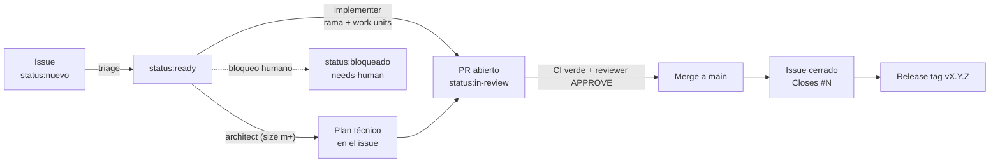

# Flujo de desarrollo — issue → PR

> Última actualización: 2026-10-27. Complementa [AGENTS.md](../../AGENTS.md): cómo se trabaja día a día en la fábrica.

Regla madre: **sin issue no hay código; `main` solo recibe merges de PR.**

## Estados y labels

| Label | Significado | Quién lo pone |
|---|---|---|
| `type:feature` · `type:bug` · `type:task` · `type:chore` | Naturaleza del trabajo | Al crear (template) |
| `status:nuevo` | Sin procesar, espera triage | Default |
| `status:ready` | Pasa DoR; implementable sin preguntas | Triage |
| `status:in-progress` | Rama abierta, trabajo en curso | Implementación |
| `status:in-review` | PR abierto | Implementación |
| `status:bloqueado` | Espera decisión/credencial humana (siempre con comentario que explique qué falta) | Cualquiera |
| `needs-human` | Requiere acción humana: dinero, credenciales, cuentas externas, legal | Triage |
| `priority:p0` · `p1` · `p2` | p0 bloquea el loop del producto · p1 esta semana · p2 cuando quepa | Triage |
| `size:xs` · `s` · `m` · `l` | xs <1h · s <4h · m <2d · l >2d (`l` ⇒ partir o chained-pr) | Triage |

## Definition of Ready (para pasar a `status:ready`)

- [ ] Problema/valor claro en una o dos frases.
- [ ] ≥ 1 criterio de aceptación **verificable** (comando, acción de usuario o estado observable).
- [ ] Alcance y no-objetivos explícitos.
- [ ] `type:`, `priority:`, `size:` asignados.
- [ ] Sin dependencias humanas pendientes (si las hay → `status:bloqueado` + `needs-human`).

## Definition of Done (para el merge)

- [ ] CI verde en los jobs del stack tocado.
- [ ] Criterios de aceptación cubiertos, con evidencia en el PR.
- [ ] Revisión aprobada, sin hallazgos P0/P1 abiertos.
- [ ] Tests y docs incluidos en los mismos commits que el comportamiento.
- [ ] Issue cerrado con `Closes #N`.
- [ ] PR ≤ 400 changed lines o chain justificada.

## Assertividad (trabajar sin preguntar)

- **El default del proceso vence a la pregunta**: decide con el default y documenta la decisión en el PR (sección "Decisiones tomadas sin preguntar").
- **Bloquear solo si**: faltan credenciales/secretos, hay coste en dinero, hay decisión legal, o hay ambigüedad que contradiga `producto.md`/ADRs. Protocolo: comenta en el issue qué falta exactamente con tu recomendación, aplica `status:bloqueado`, y sigue con el siguiente issue `status:ready`. No esperar mirando el issue.
- Las decisiones inamovibles (AGENTS.md) no se re-debaten en un PR: cambiarlas exige ADR nuevo + aprobación humana.

## Ronda de fábrica (el loop autónomo)

Ejecutar periódicamente esta secuencia mantiene la fábrica moviéndose sin intervención humana:

1. **Triage**: issues `status:nuevo` → `status:ready` / `status:bloqueado`.
2. **Arquitectura**: issues `status:ready` de `size:m+` sin plan técnico → plan en el issue.
3. **Implementación**: el issue `status:ready` de mayor prioridad sin PR → `implementer`.
4. **Revisión**: PRs abiertos sin revisar → `reviewer`.
5. **Cierre**: PR aprobado con CI verde → merge, confirmar cierre del issue, siguiente.

Reglas: un issue a la vez por rama; si todo está bloqueado o no hay trabajo `status:ready`, terminar reportando los bloqueos — nunca inventar trabajo. El merge autónomo exige CI verde + `APPROVE` + criterios con evidencia.

## Convenciones

### Ramas

`feat|fix|chore/<número-de-issue>-<slug-corto>` — ej.: `feat/7-escalation-engine`. Nacen de `main` actualizada (`git pull --ff-only`). En el monorepo, el PR toca una capa dominante y lo declara en el título: `[backend]`, `[android]`, `[ios]`, `[contracts]`, `[docs]`, `[fábrica]`.

### Commits (unidades de trabajo)

Conventional commits en inglés: `feat:` `fix:` `chore:` `docs:` `test:` `refactor:` `perf:`.

- Un commit = una unidad de trabajo entregable: comportamiento + sus tests + sus docs juntos (skill `work-unit-commits`).
- El mensaje cuenta el **resultado**, no la lista de archivos.
- El repo queda coherente tras cada commit.

### Presupuesto de revisión

PR objetivo **≤ 400 changed lines** y revisable en ~60 minutos. Si se excede: una pasada de slicing honesta con la skill `chained-pr` (stacked o feature-branch-chain). Nunca recortar el diff borrando comentarios, tests o docs: el presupuesto acota cómo se parte el trabajo, no el código.

### Idioma

- Issues, PRs, documentación: **español**.
- Código, identificadores, mensajes de commit: **inglés**.

### Secretos

Nunca en el repo: `gh secret set NAME` y `.env` local (gitignoreado). Dependencias nuevas: justificarlas en el PR contra [stack/stack.md](../stack/stack.md).

## Verificación por stack (comandos definitivos en cada Makefile/proyecto)

| Capa | Verificación |
|---|---|
| Backend Go (`/backend`) | `make test` (`go test -race ./...`) · `make lint` (`golangci-lint run`) |
| Android (`/apps/android`) | `./gradlew :app:lint testDebugUnitTest` |
| iOS (`/apps/ios`) | `xcodebuild test -scheme Tranqui -destination 'platform=iOS Simulator,name=iPhone 16'` |
| Contrato (`/contracts`) | Lint de OpenAPI + diff compatible (sin cambios rompientes, ADR-0003) |

Antes de abrir PR: suite completa + lint del stack tocado, con comando y resultado exacto registrados en el PR.

## Release

Tras merges a `main`, quien orquesta crea tag semver: `gh release create vX.Y.Z --generate-notes`. Detalles de despliegue en [ci-cd.md](ci-cd.md) (cuando exista).

## Privacidad (dominio del producto)

Cualquier cambio que toque datos personales respeta `producto.md` §H y ADR-0004: mínimos datos, **cero historial de ubicación** (geofence solo on-device), incidentes append-only, disclaimer "no es un servicio de emergencia". Un PR que persista ubicación o amplíe el alcance de datos se rechaza en revisión como **P0**, aunque funcione.
