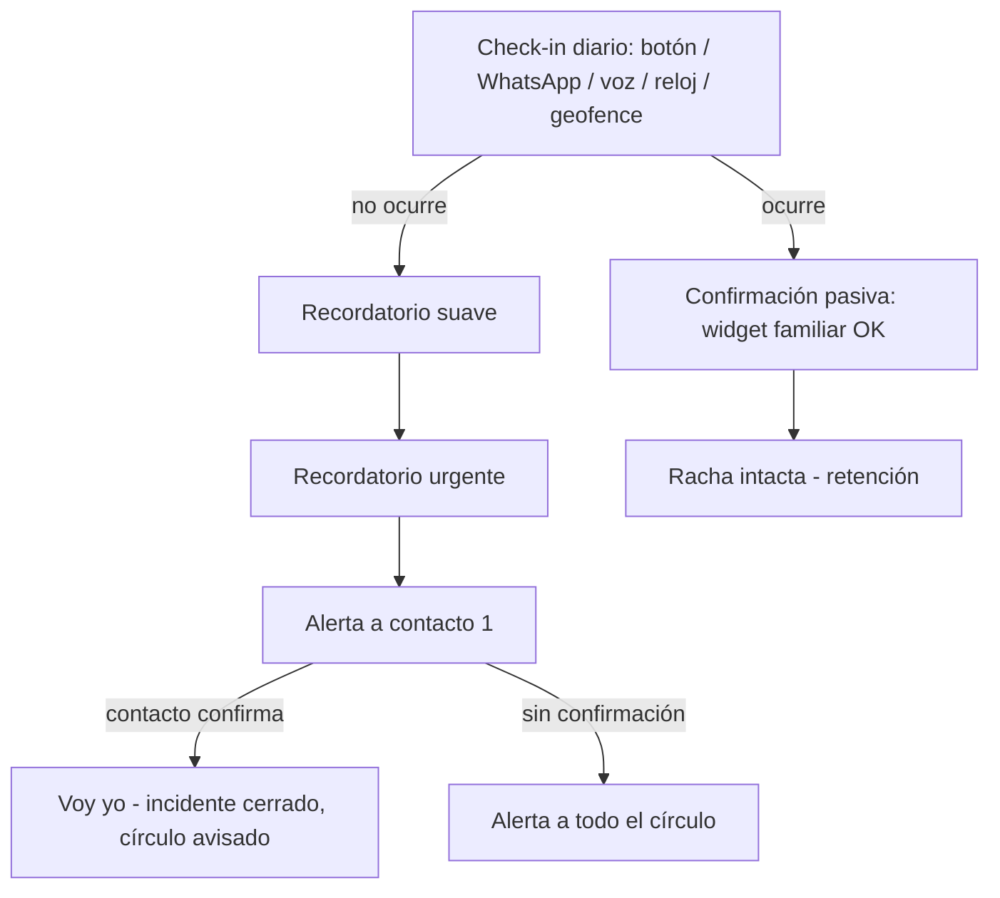

# Visión de producto

> Fuente primaria: [producto.md](../../../producto.md) (spec v0.1). Este documento es la destilación operativa; ante conflicto, gana el spec para decisiones de producto y `docs/` para las de ingeniería.
> Última actualización: 2026-10-27

## Visión en una frase

"Paz mental diaria para quien vive solo y para quien se preocupa por alguien que vive solo": un botón al día confirma que estás bien; si no lo confirmas, tu gente lo sabe de inmediato.

## El problema

- ~28% de hogares unipersonales en EE.UU. (~37M), 125M+ en China, tendencia global al alza.
- En LATAM/España, "avísame que llegaste" es un ritual diario.
- La competencia occidental está fragmentada o muerta (imalivetoday.com fuera de línea; AssureOkay sin WhatsApp, sin ubicación, sin widget social; seniorcheckin solo piloto en Perth).
- Nadie cubre: **WhatsApp-first**, check-in automático por geofence on-device, widget de lock-screen familiar, modo senior con voz transcrita, y el **mercado hispanohablante completo**.

## Personas

| Persona | Edad | Rol | Dolor | Paga |
|---|---|---|---|---|
| **P1 — El que vive solo** | 20–35 | Usuario viral | Soledad, seguridad, "mi mamá me pregunta a diario si llegué bien" | Quizá (freemium) |
| **P2 — El hijo remoto** | 35–55 | El pagador principal | Vive lejos de su padre/madre mayor; ansiedad y culpa diarias | Sí, seguro ($8–10/mes) |
| **P3 — El senior** | 65+ | Usuario final del modo senior | No domina apps, vive solo, miedo a "que pase algo y nadie se entere" | No paga él (paga P2) |
| **P4 — Casos secundarios** | — | Viajero solo, condición crónica, single parent, pareja LDR | "¿Y si me pasa algo y nadie lo nota?" | Freemium → premium |

**Insight central**: en P2 el que paga **no** es el usuario final. El valor no es el botón: es la tranquilidad del que se preocupa. El producto vende "deja de revisar el 'visto por última vez'".

## El loop central

Cada usuario necesita invitar 1–3 contactos para que el producto valga → **invitar contactos ES usar el producto**: loop viral estructural.

## Principios de producto

1. **El check-in no requiere abrir la app** (WhatsApp, voz, geofence, reloj).
2. **Cero falsas alarmas por diseño**: escalera larga por defecto, gracia, confirmación en 2 pasos, modo viaje.
3. **Honestidad radical**: es un servicio de notificación entre personas, **no** un servicio de emergencia; sin claims médicos.
4. **Mínimos datos**: nombre, teléfono, contactos; cero historial de ubicación.
5. **Calidez en cada copy**: hablamos como la familia, no como un sistema.

## No-objetivos

- Ser un botón de emergencia 911/112 o teleasistencia médica (F5/B2B es otro producto).
- Tracking de ubicación continuo o social.
- Chat/red social completa (solo el mínimo "walkie-talkie" en F4).

## KPIs (gates de salida del MVP)

| KPI | Objetivo |
|---|---|
| Check-in rate D7 | ≥ 60% |
| Falsas alarmas | < 1% por usuario activo/mes |
| Usuarios que invitan ≥ 1 contacto en 1ª sesión | ≥ 40% |
| Conversión trial→pagado a 30 días | ≥ 5% |

Estos KPIs se exponen como métricas de producto (ver [observabilidad](../observabilidad/observabilidad.md)).
